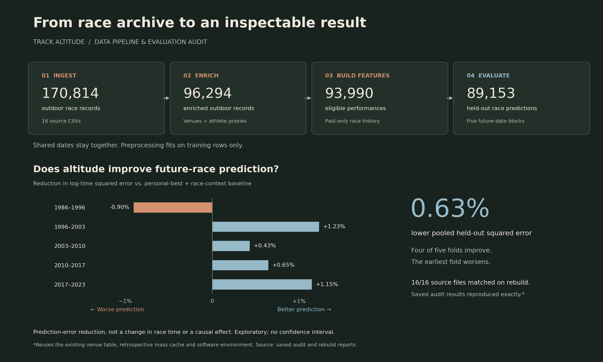

# Altitude and elite race performance

**A reproducible data pipeline and evaluation audit of 93,990 race performances.**

Does altitude help predict an elite athlete’s next race once their recent best and race context are accounted for? This project builds the data pipeline, tests that question on future races, and investigates where a plausible explanation stops being supported by the data.

**Python · data ingestion and enrichment · temporal features · evaluation tooling**

## What I built

- **An inspectable data pipeline:** ingest event/sex archives, enrich venue and athlete attributes, and record source and input fingerprints.
- **An evaluation harness:** derive personal-best features from earlier races, keep same-day races together, and fit preprocessing on training data only.
- **Checks that challenge the result:** test time boundaries and known-effect recovery, inspect comparison-group support, and rebuild from freshly downloaded race data.

The work combined AI-assisted implementation and analysis with researcher-led challenges to feature design and interpretation. The audit also uncovered mistakes in the evaluation code itself.

## What the audit found

Adding altitude terms lowered **held-out squared error in log race time by 0.63%** beyond a personal-best and race-context baseline. Four of five chronological folds improved; the earliest worsened. Expanded controls produced a similar **0.59%** gain.

The most consequential correction was to an apparent reversal in group differences: after repairing the residual analysis, the reversal disappeared. I withdrew that claim. This made the final result less dramatic and the reasoning more defensible.

A fresh race-data rebuild matched **all 16 source files** and reproduced the saved audit results exactly, using the existing venue table, mass cache, and software environment.

**Interpretation:** the 0.63% measures prediction-error reduction, not faster race times or a causal altitude effect. This remains an exploratory audit, with no confidence interval for the gain. Repeat athletes and venues, retrospective mass proxies, and limited group overlap constrain what can be concluded. [Methods and limitations →](WRITEUP.md)

## Explore the work

| If you want to… | Start here |
|---|---|
| Follow the investigation and its corrections | [Technical case study](WRITEUP.md) |
| Inspect the implementation | [Evaluation code](evaluation.py) · [Boundary tests](tests/test_evaluation.py) |
| Rebuild the analysis | [Reproduction guide](REPRODUCING.md) |
| Check the evidence and data origin | [Audit results](results/audit.json) · [Rebuild report](results/fresh_download.json) · [Provenance](DATA_PROVENANCE.json) |

Race data come from [mexwell’s World Athletics Database on Kaggle](https://www.kaggle.com/datasets/mexwell/world-athletics-database), which credits thomascamminady. Raw and derived race CSVs are not bundled; the reproduction guide explains how to rebuild them. Earlier interpretations in [RESEARCH_NOTES.md](RESEARCH_NOTES.md) are superseded by the current case study.
